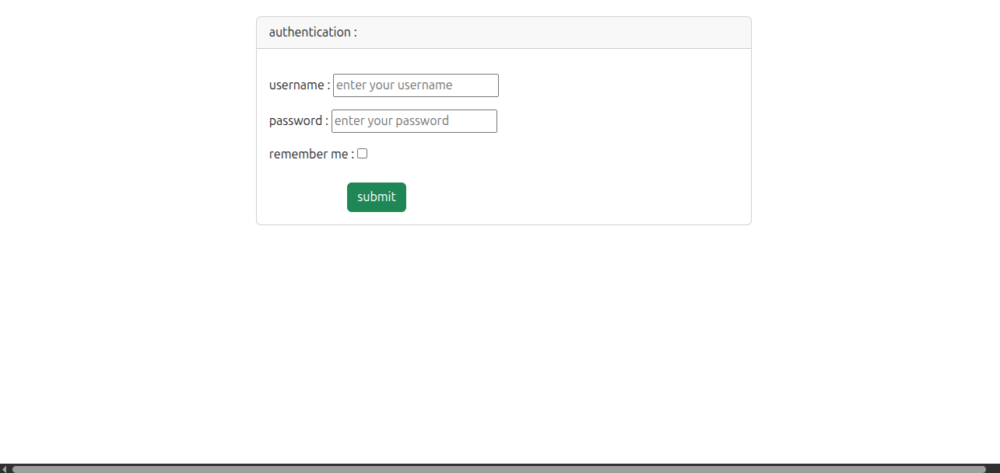
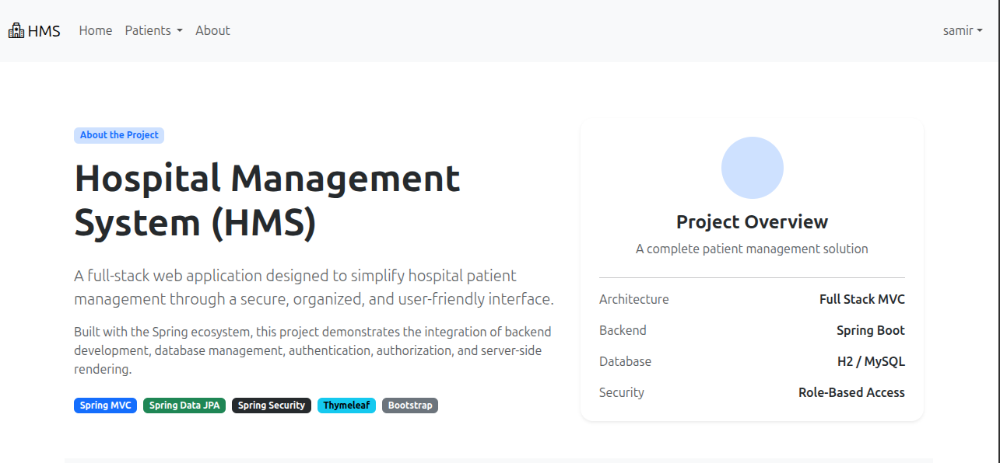
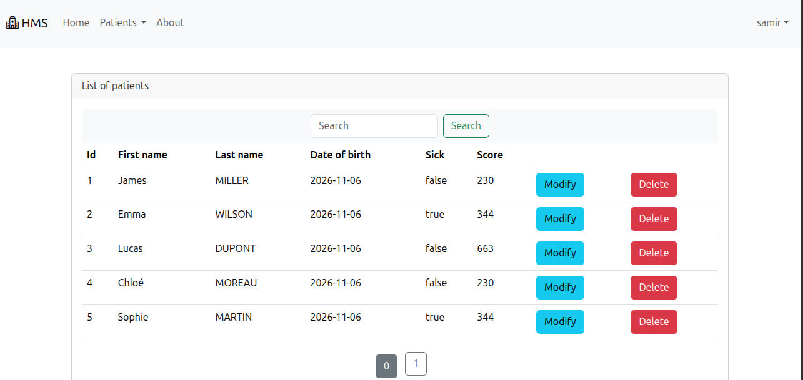

# 🏥 Hospital Management System

A full-stack web application designed to manage patient information efficiently through a secure and user-friendly interface.

Built with the **Spring ecosystem**, this project demonstrates the integration of backend development, database management, authentication, authorization, and server-side rendering.

---

## ✨ Features

- 📋 **Patient Management:** View and manage patient information.
- ✏️ **Update Patients:** Modify existing patient records.
- ➕ **Add Patients:** Create new patient records (Admin only).
- 🗑️ **Delete Patients:** Remove patient records (Admin only).
- 🔐 **Authentication:** Secure login using Spring Security.
- 👥 **Role-Based Access Control:** Different permissions for `USER` and `ADMIN`.
- 🗄️ **Database Integration:** Support for H2 and MySQL.
- 🎨 **Responsive UI:** User interface built with Thymeleaf and Bootstrap.

---
## Login page

---
## About page

---
## Home page


--- 

## 🛠️ Technologies Used

| Technology | Description |
|---|---|
| Java | Programming language |
| Spring Boot | Application framework |
| Spring MVC | Web application architecture |
| Spring Data JPA | Database persistence |
| Spring Security | Authentication and authorization |
| Thymeleaf | Server-side template engine |
| Bootstrap | Responsive frontend design |
| H2 Database | Default database configuration |
| MySQL | Alternative relational database |
| Maven | Dependency management and build tool |

---

## 👥 User Roles & Permissions

The application supports two roles:

### 👤 USER

Regular users can:

- View the list of patients.
- Update existing patient information.

They cannot add or delete patients.

### 👑 ADMIN

Administrators have full access to patient management operations:

- View patients.
- Update patient information.
- Add new patients.
- Delete patients.

---

## 🔑 Demo Credentials

Use the following credentials to log in and explore the application.

### 👤 User Account

| Field | Value |
|---|---|
| Username | `user` |
| Password | `123` |
| Role | `USER` |

### 👑 Administrator Account

| Field | Value |
|---|---|
| Username | `samir` |
| Password | `123` |
| Role | `ADMIN and  USER` |


---

## 🗄️ Database Configuration

The application supports two database configurations:

### H2 Database (Default)

H2 is used as the default database configuration.

It provides a lightweight database environment suitable for development and testing.

### MySQL (Alternative)

The application can also be configured to use MySQL.

To use MySQL:

1. Install and start MySQL Server.
2. Create a database for the application.
3. Configure the datasource URL, username, and password in `application.properties`.
4. Disable the H2 database configuration.
5. Restart the application.

---

## 🔐 Authentication

Spring Security is used to manage authentication and authorization.

The project supports two authentication strategies:

- **In-Memory Authentication:** User details are configured and stored in memory.
- **Database-Based Authentication:** User details are retrieved from the database through a custom `UserDetailsService` implementation.

The authentication strategy can be selected through the Spring Security configuration.

---

## 🚀 Getting Started

### Prerequisites

Make sure you have installed:

- Java JDK
- Maven

For the MySQL configuration, you also need MySQL Server.

### 1. Clone the repository

```bash
git clone git@github.com:samirfandi/HospitalManagementSystem.git
```

### 2. Navigate to the project directory

```bash
cd hospital/
```

### 3. Run the application

Using Maven:

```bash
./mvnw spring-boot:run
```

Alternatively, open the project in your IDE and run the main Spring Boot application class.

### 4. Open the application

Once the application has started, open:

```text
http://localhost:8080
```

Log in using one of the demo accounts provided above.

---

## 🎯 Project Objectives

This project was developed to practice and improve my skills in:

- Full-stack Java development.
- Spring Boot application development.
- Spring MVC architecture.
- Database integration using Spring Data JPA.
- Authentication and authorization with Spring Security.
- Server-side rendering with Thymeleaf.
- Responsive frontend development with Bootstrap.

---

## 👨‍💻 Author

**Samir**

A full-stack Java project built to explore the Spring ecosystem and develop practical web application development skills.

---

⭐ If you find this project interesting, feel free to explore the source code!
